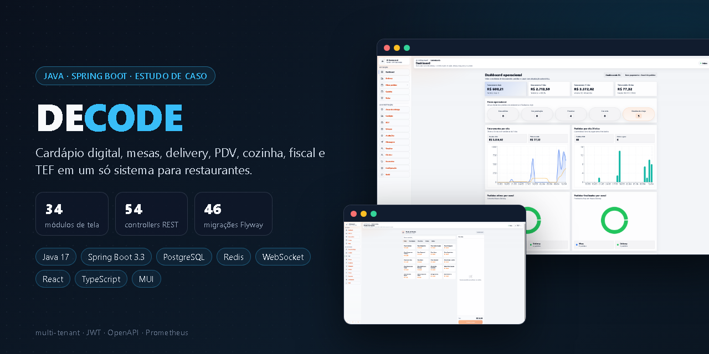

# DECODE — sistema para lanchonetes e restaurantes

> **Estudo de caso.** O código do sistema operacional é privado; aqui estão o problema, a arquitetura, as decisões técnicas e as telas.
> O painel administrativo do produto é público: [admin_DecodeBack](https://github.com/LeandrSDEV/admin_DecodeBack) (API) · [admin_DecodeFront](https://github.com/LeandrSDEV/admin_DecodeFront) (front).
> Demonstração e acesso ao código sob solicitação — [LinkedIn](https://www.linkedin.com/in/leandro-js-santos/).

        

## O problema

Lanchonetes e restaurantes pequenos costumam operar com papel, planilha e conversa de WhatsApp: o pedido da mesa se perde, a taxa de entrega é calculada no olho, a cozinha não vê a fila e o caixa fecha sem relatório. O DECODE junta tudo isso em um único sistema, em tempo real, para eliminar processos manuais e erros operacionais.

## O que o sistema faz

| Atendimento | Operação | Gestão |
| --- | --- | --- |
| Cardápio digital público | PDV (ponto de venda) | Dashboard de faturamento e pedidos |
| Pedido pela mesa via QR Code | Tela da cozinha em tempo real | Estoque, ingredientes, modificadores e variantes |
| Delivery com área de entrega por polígono e taxa | Rotas de entrega | Cupons e promoções |
| Acompanhamento do pedido pelo cliente | Impressão por agente local | Fiscal e TEF |
| Avaliações | Encomendas e pedidos agendados | Usuários e permissões |
| Robô de atendimento no WhatsApp | Pagamento PIX | Mensagens em massa (broadcast) |

## Arquitetura

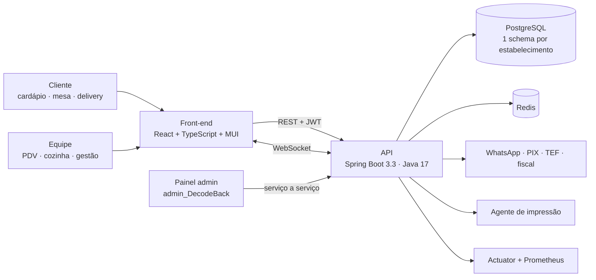

## Decisões técnicas

- **Multi-tenant com schema por estabelecimento.** Um filtro identifica o tenant em cada requisição; o Hibernate troca o `search_path` do PostgreSQL pela conexão (`MultiTenantConnectionProvider`). Os dados de cada cliente ficam isolados numa única instância de banco.
- **Migrações por tenant.** O Flyway versiona o banco (46 migrações) e aplica as migrações em cada schema de estabelecimento.
- **Onboarding automatizado.** O painel admin cria e configura tenants por chamadas serviço a serviço, sem intervenção manual.
- **Tempo real com WebSocket** para a cozinha e o acompanhamento do pedido.
- **Integrações resilientes** com Resilience4j nas chamadas externas.
- **Observabilidade** com Spring Boot Actuator, Micrometer e Prometheus.
- **Segurança** com Spring Security e JWT.
- **Contrato da API** documentado com springdoc OpenAPI.
- **Arquivos:** importação de cardápio por planilha (Apache POI) e geração de PDF (OpenPDF).

## Em números

| 54 | ~376 | 48 | 46 | 34 |
| :---: | :---: | :---: | :---: | :---: |
| controllers REST | classes Java | entidades | migrações Flyway | módulos de tela |

## Telas

<table>
  <tr>
    <td width="50%">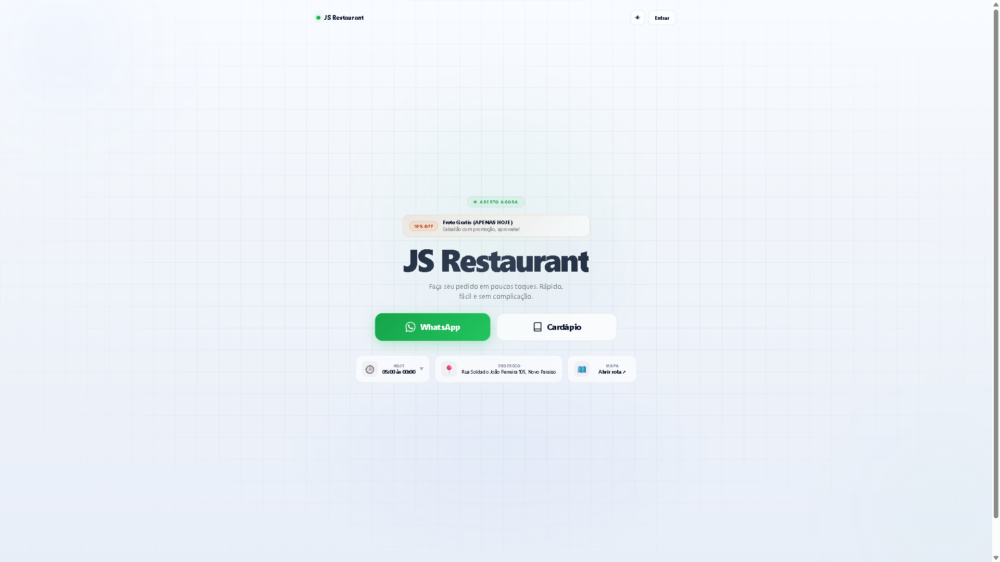 Página da loja</td>
    <td width="50%">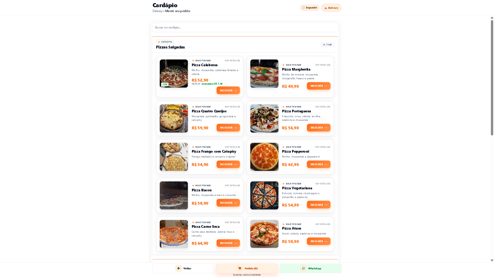 Cardápio digital</td>
  </tr>
  <tr>
    <td>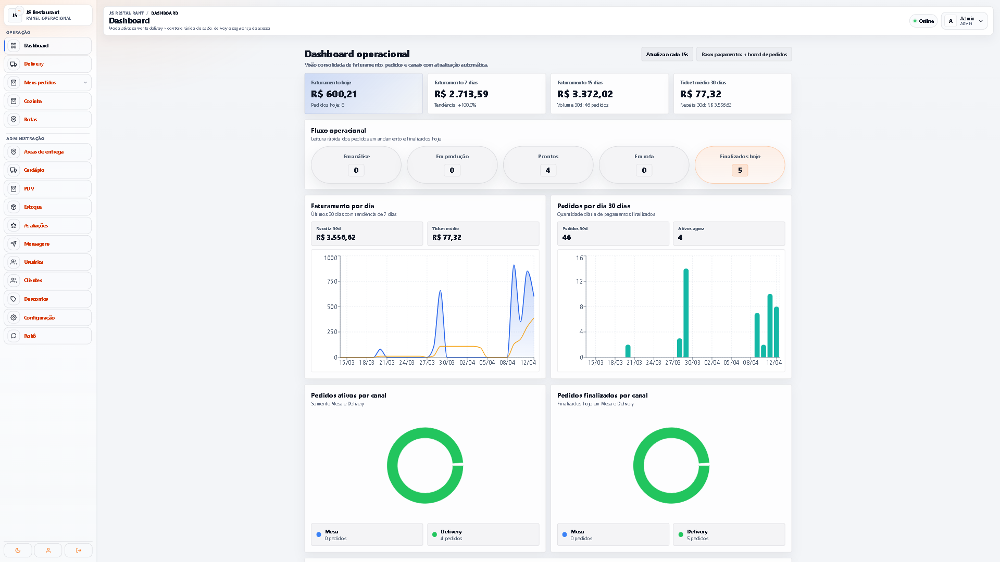 Dashboard operacional</td>
    <td>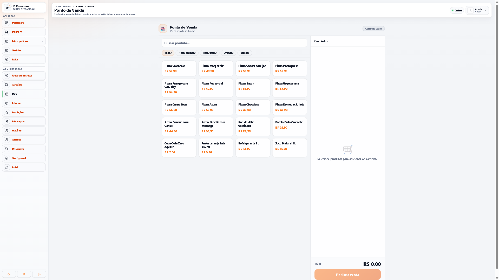 PDV</td>
  </tr>
  <tr>
    <td>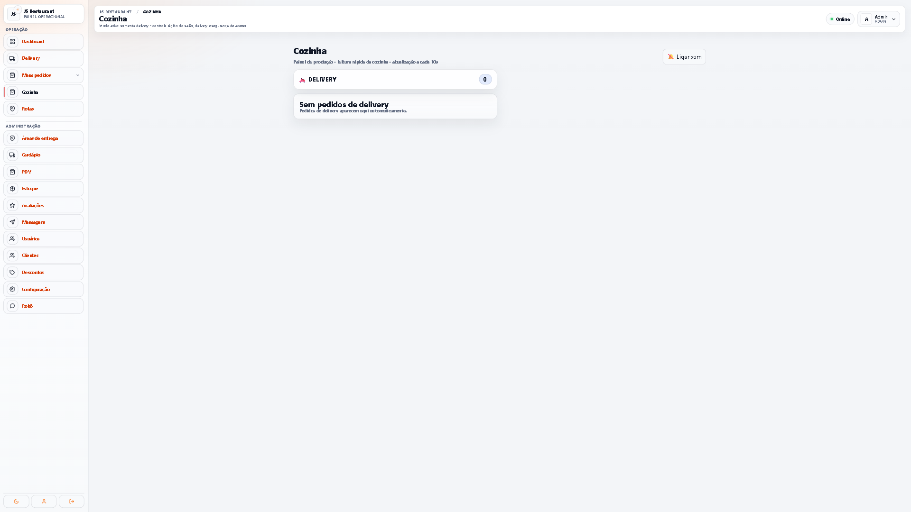 Cozinha</td>
    <td>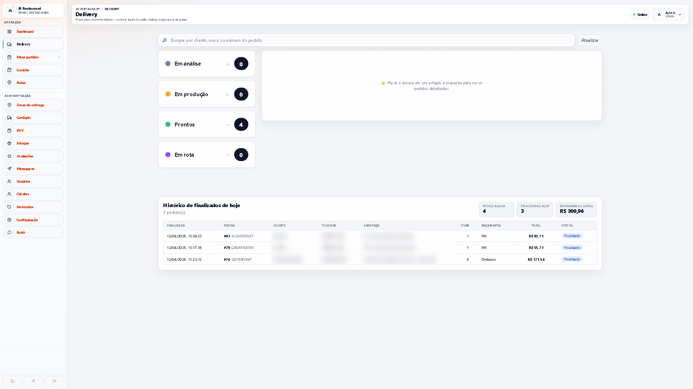 Delivery</td>
  </tr>
  <tr>
    <td>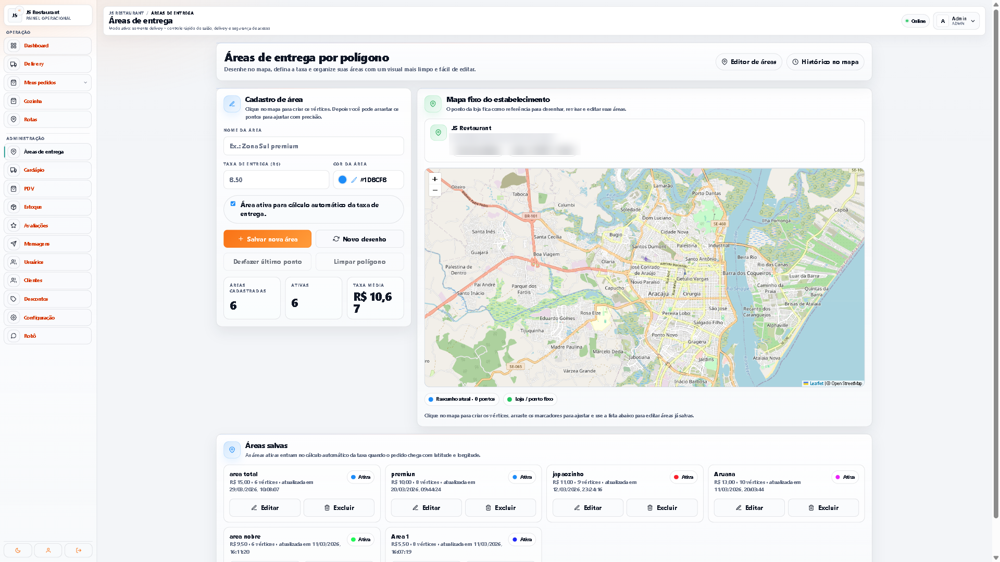 Áreas de entrega por polígono</td>
    <td>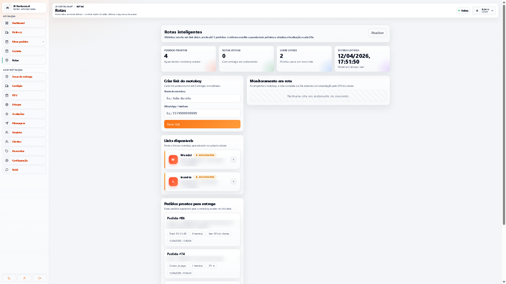 Rotas de entrega</td>
  </tr>
  <tr>
    <td>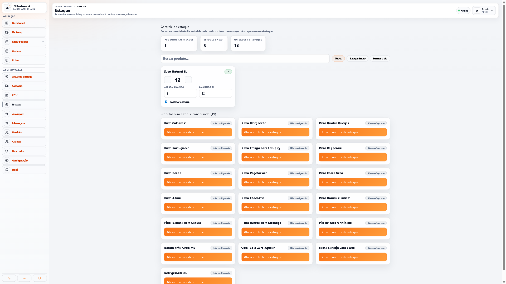 Estoque</td>
    <td>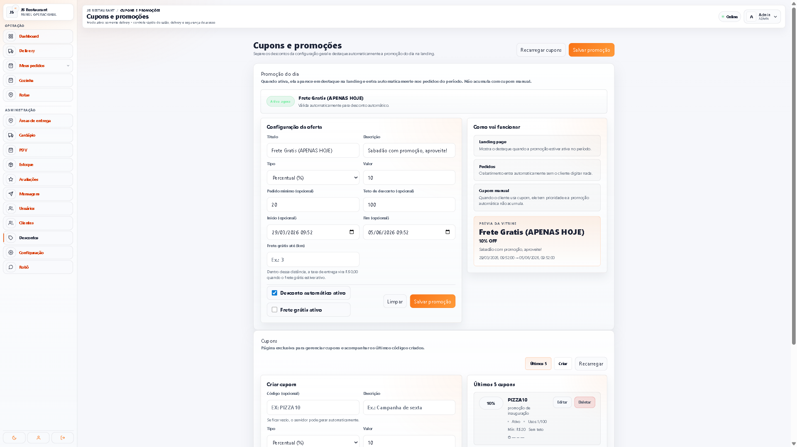 Cupons e promoções</td>
  </tr>
  <tr>
    <td>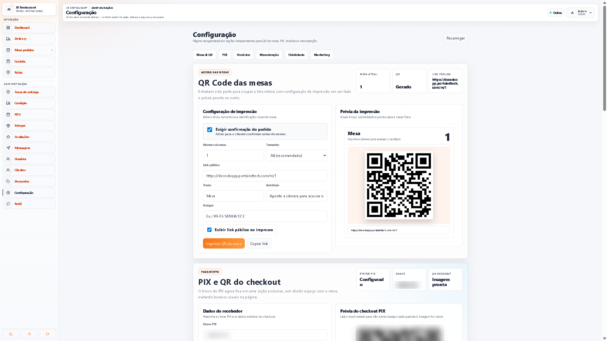 Configuração e QR Code das mesas</td>
    <td>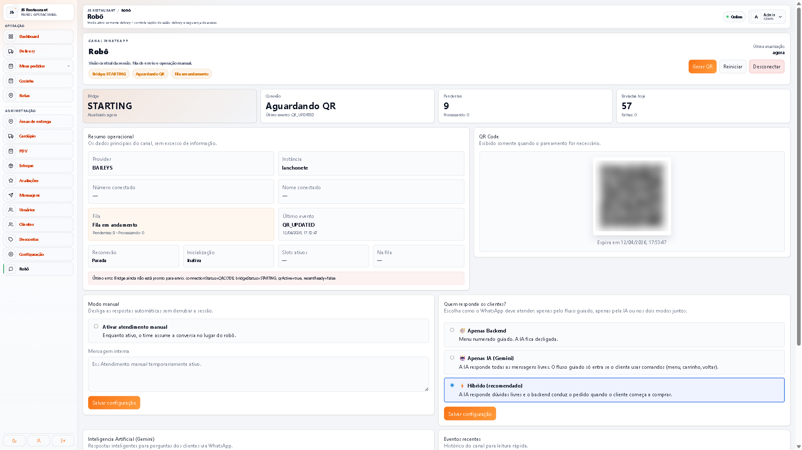 Robô do WhatsApp</td>
  </tr>
</table>

Telas da loja de demonstração "JS Restaurant". Endereços e dados de clientes aparecem desfocados.

## Stack

| Camada | Tecnologias |
| --- | --- |
| Back-end | Java 17, Spring Boot 3.3, Spring Security, JWT (jjwt), Spring Data JPA, WebSocket, Resilience4j, springdoc OpenAPI |
| Dados | PostgreSQL (schema por tenant), Flyway, Redis |
| Front-end | React, TypeScript, Material UI, React Router, Recharts, Axios |
| Operação | Docker, Actuator, Micrometer, Prometheus |

---

**Leandro de Jesus Santos** — [LinkedIn](https://www.linkedin.com/in/leandro-js-santos/) · [Portfólio](https://leandrsdev.github.io/portfolio-web/) · [GitHub](https://github.com/LeandrSDEV)
